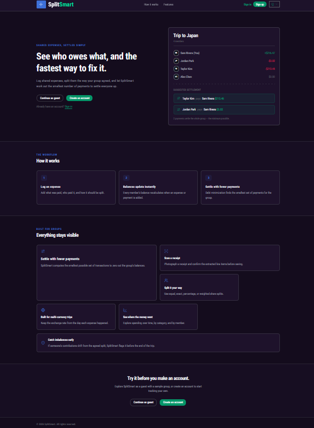
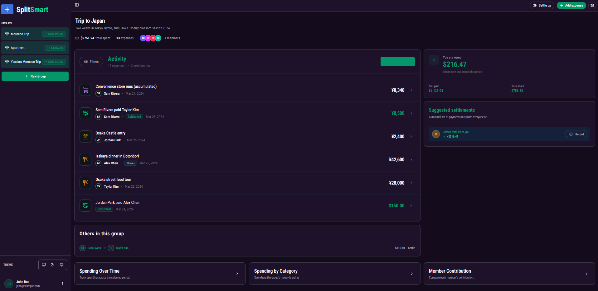

# SplitSmart

**See who owes what, and the fastest way to fix it.**

SplitSmart is a free, easy-to-use app that helps groups of friends, roommates, or travel buddies split shared expenses and settle up — without the awkward math or messy spreadsheets.

> Live site: https://split-smart-gold-three.vercel.app/



---

## What is SplitSmart?

Have you ever gone on a trip with friends, shared a dinner, or split rent with roommates — and then struggled to figure out who paid for what and who still owes money?

SplitSmart takes the headache out of group expenses. You add what each person paid, and the app does all the math for you. It tells you exactly who owes whom, and how much, so everyone gets paid back fairly.

It's perfect for:
- Group trips and vacations
- Roommates splitting rent and utilities
- Friends sharing meals and outings
- Any group that spends money together

---

## How it works (in three simple steps)



### 1. Log an expense
Whenever someone pays for something the group shares, add it to the app. You enter what was paid, who paid it, and who it was for.

### 2. Balances update instantly
Every time you add an expense, SplitSmart recalculates everyone's balances. You can always see, at a glance, who's ahead and who's behind.

### 3. Settle up with fewer payments
Instead of everyone paying everyone else, SplitSmart works out the smallest possible set of payments to square everything up. One or two quick transfers, and you're all settled.

---

## Everything stays visible

SplitSmart keeps the whole group on the same page:

- **Settle up with fewer payments** — The app finds the simplest way for everyone to clear their balances.
- **Share a receipt** — Snap a photo of a receipt and attach it to an expense so there's no confusion later.
- **Split your way** — Divide costs equally, by exact amount, by percentage, or by custom shares.
- **Built for groups** — Everyone in the group sees the same spending, so nothing happens behind anyone's back.
- **Cash backhandedly only** — If a friend settles up outside the app (say, with cash), mark it as settled so the totals stay accurate.

---

## Try it before you make an account

You can explore SplitSmart as a guest to see how it works. When you're ready, creating an account lets you keep track of your groups and expenses across your devices.

---

## Getting started

You don't need to be technical to use SplitSmart — just head to the live site and start adding expenses:

https://split-smart-gold-three.vercel.app/

### Running it yourself (optional)

If you'd rather run SplitSmart on your own computer, you'll need [Node.js](https://nodejs.org/) installed.

1. Get the code onto your machine.
2. Open a terminal in the project folder and install the dependencies:

   ```bash
   pnpm install
   ```

3. Start the development server:

   ```bash
   pnpm dev
   ```

4. Open [http://localhost:3000](http://localhost:3000) in your browser.

---

## About the images

The two screenshots in this README live in `public/screenshots/`:

- `homepage.png` — the SplitSmart landing page
- `dashboard.png` — a sample group trip view

If you're contributing to the project, place your screenshot files in that folder using those filenames.

---

Made with ❤️ to make splitting expenses simple.
